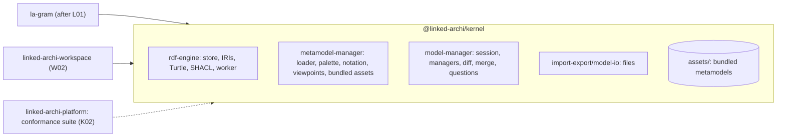

# Design: linked-archi-kernel

## Overview

The kernel is la-gram's model logic, copied out of la-gram with nothing changed but one test, and packaged for two
users: la-gram itself, once its migration task (L01) has moved it onto the package, and the Linked.Archi workspace,
from its ticket W02. How each module works is described in la-gram's design
(`la-gram/.agents/specs/la-gram/design.md`), which stays the reference until K02 moves the parts that are the
kernel's here.

## What came across, and what stayed

| Came across | Files |
|---|---|
| `src/rdf-engine/`, `src/metamodel-manager/`, `src/model-manager/`, with their tests | all, except 14 tests |
| `src/import-export/model-io.ts` and its test | `model-merge.ts` reads model files through it, and the kernel's API serializes models |
| `src/types/build-flags.d.ts` | declares the build-time globals two modules read |
| `src/__tests__/fixtures/merge/`, `diff/`; `src/__tests__/sync-assets.test.ts` | fixtures of the merge, diff and missing-reference tests; the asset sync's test |
| `scripts/sync-assets.mjs`, `scripts/bench-model.mjs` | the asset refresh; the generated models of the timing tests |
| `assets/` | the bundled metamodels, 271 files |

The 14 tests that stayed in la-gram import la-gram's application (`src/app.ts`), its canvas or its command-line
tool. They test the modules through the application:

  - `src/metamodel-manager/__tests__/basic-metamodel.test.ts`
  - `src/metamodel-manager/__tests__/catalogue.test.ts`
  - `src/metamodel-manager/__tests__/palette-snapshot.test.ts`
  - `src/model-manager/__tests__/folders.test.ts`
  - `src/model-manager/__tests__/iri-conformance.test.ts`
  - `src/model-manager/__tests__/model-contents-index.test.ts`
  - `src/model-manager/__tests__/property-catalog.test.ts`
  - `src/model-manager/__tests__/provenance.test.ts`
  - `src/model-manager/__tests__/questions.test.ts`
  - `src/model-manager/__tests__/rdf-scope.test.ts`
  - `src/model-manager/__tests__/relationship-lookup-memo.test.ts`
  - `src/model-manager/__tests__/relationship-ranking.test.ts`
  - `src/model-manager/__tests__/relationship-validity.test.ts`
  - `src/rdf-engine/__tests__/validation-engine.test.ts`

They keep running in la-gram against its copy, and against the package after L01. K02 decides whether any is
rewritten on the kernel's API.

## Key design decisions

- **KD-1 The same paths as la-gram.** The modules keep `src/rdf-engine/…`, `src/metamodel-manager/…`,
  `src/model-manager/…` and `src/import-export/model-io.ts`.
  - A fix copies to la-gram file for file while it still holds a copy (`conventions.md`).
  - Git history imported with `git filter-repo --path …` lands on the same files.
  - la-gram's migration changes import paths only.
  - Renaming the layout, if ever, waits until L01 has ended.
- **KD-2 A source package.** The package publishes its TypeScript, and the consumer's bundler or test runner
  compiles it.
  - **Why.** The modules already rely on being bundled:
    - the validation worker is created as `new Worker(new URL('./validation.worker.ts', import.meta.url))`, which
      webpack and Vite turn into a worker chunk, while `tsc` would leave a `.ts` path that no longer exists;
    - `bundled-assets.ts` finds `assets/` from `import.meta.url`;
    - Oxigraph's WebAssembly is resolved by the bundler.

    Publishing the source keeps all three working as they do in la-gram, and keeps the code byte-identical.
  - **The cost.** A consumer needs a TypeScript-aware bundler or runner (Vite, webpack with ts-loader, Vitest). All
    current consumers have one. la-gram-git, its command-line tool, is bundled by la-gram's webpack.
  - **A compiled build** is reconsidered in K02, if a consumer needs one.
- **KD-3 The bundled metamodels ship in the kernel.** `assets/` and `bundled-assets.ts`, the registry that names its
  files, are one unit: a change to one is a change to the other. So the kernel owns both, and owns their refresh
  (`npm run sync-assets`).
  - **In Node**, the existing discovery walks up from `src/metamodel-manager/` to the package root and finds
    `assets/`, in this repository and in an installed package alike.
  - **In a browser**, the application copies `assets/` into its build, as la-gram's webpack already does from its
    own folder. Today the URL is resolved against `document.baseURI`. A host page is not the workspace's asset
    location, so K02 makes the base a setting (workspace WD-7).
  - **Answers K01's question** of where bundled metamodels ship.
- **KD-4 Tests that need la-gram's application stay in la-gram.** The 14 above. Copying them would bring the
  application with them.
- **KD-5 A provisional API until K02.**
  - **Entry points:** `.` exports each module as a namespace (`rdfEngine`, `metamodelManager`, `modelManager`,
    `modelIo`), so names the modules share do not clash. `./rdf-engine`, `./metamodel-manager` and
    `./model-manager` export the modules' own `index.ts`. `./*.js` reaches any module file by its path.
  - **Why so open:** that is what la-gram's migration needs, since la-gram imports module files directly.
  - **K02** freezes the public API from what the workspace's inventory and fact sheet and la-gram actually call, and
    narrows the exports to it.

## Open questions

| Question | Decided in |
|---|---|
| A compiled build beside the source (KD-2) | K02, if a consumer needs one |
| How the validation worker is created, so each bundler can build it: Vite needs `{ type: 'module' }` for a worker with ES imports | K02, with W02's first run |
| The browser asset base as a setting (KD-3) | K02 |
| The tool's identity in provenance, now la-gram's (`model-manager/provenance.ts`) | K02 |
| Kernel-neutral names for the build flags `__LA_GRAM_ASSETS_VERSION__` and `__LA_GRAM_BUILD__` | K02 |
