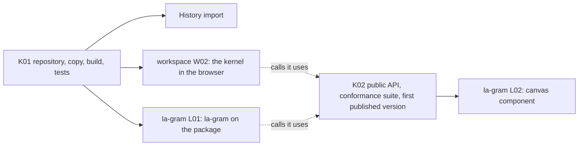

# Plan: linked-archi-kernel

The kernel's part of the platform's editing track (`linked-archi-platform/docs/plan.md`, E0, tickets K01, K02 and
L01). Baseline: **20 November 2026**.

| Ticket | Work | Done when |
|---|---|---|
| **K01** | Repository; the modules, their tests, fixtures, scripts and assets copied from la-gram; package, type-check, tests, CI; Git history imported | `npm install`, `npm run typecheck` and `npm test` pass; `npm pack` produces a tarball that installs in an empty project; the history import matches the copy file for file |
| **K02** | The public API, frozen from the calls the workspace (W03, W04) and la-gram (L01) make; the findings queued in `tasks.md`; the conformance suite; the first published version | A published version installs from the registry; the conformance suite gives the same IRIs, Turtle and findings in the kernel, la-gram and the platform's validator |

**L01:** la-gram consumes the same installed archive as the workspace as of 2026-11-24. Its migration task
records web/desktop/CLI/browser checks and the API inventory. Shared modules are no longer copied between
repositories. Updates are made here and delivered through a qualified archive and consumer lockfiles.
The migration task retains explicit closure checks; E1/A remains open for the full metamodel matrix.

## K01 qualification and remaining work

The source copy, typecheck, tests and packed 0.1.4 consumer checks have passed locally. The tarball from
kernel `b96d741` matches the pin in both consumers, and an empty Vitest project loaded its RDF store and
bundled assets. The [task log](tasks.md) records the evidence.

The original Git history and clean CI evidence are the remaining K01 items. Use the recorded pre-migration
source reference for the [history import](../../tasks/import-from-la-gram/README.md).
