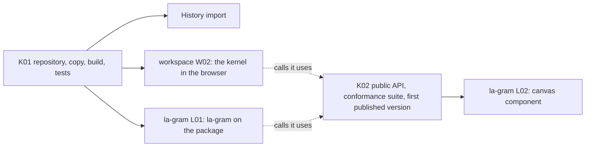

# Plan: linked-archi-kernel

The kernel's part of the platform's editing track (`linked-archi-platform/docs/plan.md`, E0, tickets K01, K02 and
L01). Baseline: **20 November 2026**.

| Ticket | Work | Done when |
|---|---|---|
| **K01** | Repository; the modules, their tests, fixtures, scripts and assets copied from la-gram; package, type-check, tests, CI; Git history imported | `npm install`, `npm run typecheck` and `npm test` pass; `npm pack` produces a tarball that installs in an empty project; the history import matches the copy file for file |
| **K02** | The public API, frozen from the calls the workspace (W03, W04) and la-gram (L01) make; the findings queued in `tasks.md`; the conformance suite; the first published version | A published version installs from the registry; the conformance suite gives the same IRIs, Turtle and findings in the kernel, la-gram and the platform's validator |

**L01**, la-gram's move onto the package, is la-gram's own task. It starts as soon as K01's tests pass. Until it ends,
the rule in `conventions.md` holds: fix here first, copy to la-gram.

## K01 order

1. **Copy.** Done 2026-11-20.
2. **Install, type-check and test.** Fix what fails, here and in la-gram alike if the cause is in the shared code.
3. **Import the history.** Follow `.agents/tasks/import-from-la-gram/README.md` once Git works on the machine.
4. **Pack.** Run `npm pack` and install the tarball in an empty project.
5. **Hand over.** Tell W02 and L01 that the package is usable, as the packed tarball (README, *Use*).
